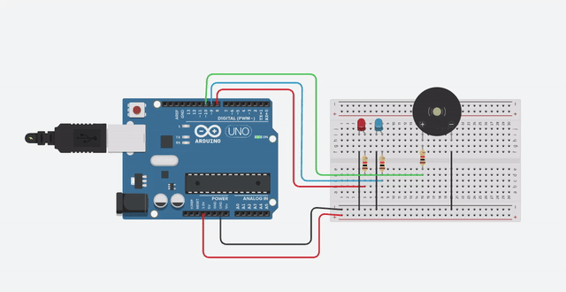

# 🚨 Sirene com Arduino

Projeto simples de Arduino que simula uma **sirene de viatura**: dois LEDs (vermelho e azul) piscam de forma alternada enquanto um buzzer piezo alterna entre dois tons, um grave e um agudo.



## 📋 Como funciona

O código roda em loop infinito e repete duas fases, cada uma com **300 ms**:

| Fase | LED azul (pino 9) | LED vermelho (pino 8) | Som do piezo (pino 10) |
|------|-------------------|-----------------------|------------------------|
| 1    | Aceso             | Apagado               | 1000 Hz (grave)        |
| 2    | Apagado           | Aceso                 | 1500 Hz (agudo)        |

Funções principais usadas:

- `pinMode(pino, OUTPUT)`: configura o pino como saída.
- `digitalWrite(pino, HIGH/LOW)`: liga ou desliga o LED.
- `tone(pino, frequencia)`: gera um som na frequência indicada (em Hz).
- `noTone(pino)`: para o som.
- `delay(ms)`: espera o tempo informado em milissegundos.

## 🧰 Materiais utilizados

- 1x Arduino UNO
- 1x LED vermelho
- 1x LED azul
- 1x Buzzer piezo
- 3x Resistores (um para cada componente)
- 1x Protoboard
- Jumpers / fios

## 🔌 Ligações

| Componente      | Pino do Arduino |
|-----------------|-----------------|
| LED vermelho    | 8               |
| LED azul        | 9               |
| Buzzer (piezo)  | 10              |
| GND dos componentes | GND         |

Cada LED e o buzzer passam por um resistor antes de ir ao pino do Arduino, e os outros terminais vão ao GND pela protoboard.

> 💡 Dica: para os LEDs, resistores de 220 Ω a 330 Ω são o padrão.

## ▶️ Como abrir e executar

### Opção 1: Simulador online (Tinkercad)
1. Acesse [tinkercad.com](https://www.tinkercad.com/) e crie uma conta gratuita.
2. Vá em **Circuits** e crie um novo circuito.
3. Monte as ligações da tabela acima.
4. Clique em **Code**, escolha **Text** e cole o conteúdo de `sirene.ino`.
5. Clique em **Start Simulation**.

### Opção 2: Arduino real
1. Instale a [Arduino IDE](https://www.arduino.cc/en/software).
2. Abra o arquivo `sirene.ino`.
3. Conecte o Arduino UNO ao computador via USB.
4. Em **Ferramentas → Placa**, selecione *Arduino UNO* e escolha a porta correta.
5. Clique em **Carregar (Upload)**.

## 📁 Estrutura do projeto

```
sirene-arduino/
├── sirene.ino   # Código do Arduino
├── demo.gif     # Demonstração do funcionamento
└── README.md    # Este arquivo
```

## ✏️ Personalizando

- Altere o valor dos `delay()` para uma sirene mais rápida ou lenta.
- Mude as frequências em `tone()` para outros sons.
- Adicione mais LEDs para um efeito mais completo.

## 📄 Licença

Projeto de estudo, livre para usar e modificar.
