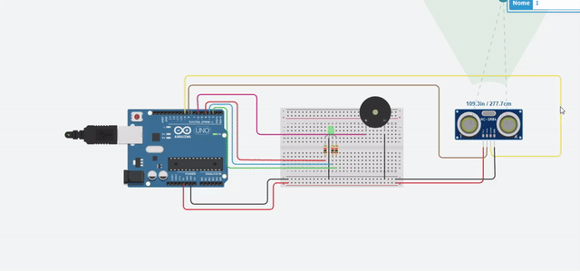

# 📏 Sensor de Distância com Arduino

Projeto de Arduino que funciona como um **sensor de ré**: um sensor ultrassônico mede a distância até um objeto e, quanto mais perto ele estiver, mais rápido e mais agudo fica o bipe, enquanto um LED RGB muda de cor (verde → amarelo → vermelho).



## 📋 Como funciona

1. O Arduino manda um pulso de som pelo pino **TRIG** do sensor HC-SR04.
2. O som bate no objeto e volta; o pino **ECHO** mede quanto tempo isso levou (`pulseIn`).
3. O tempo é convertido em centímetros: `distancia = duracao * 0.034 / 2`.
4. Dependendo da distância, o Arduino acende o LED RGB e toca o buzzer de um jeito diferente:

| Distância         | LED RGB                    | Buzzer                                        |
|-------------------|----------------------------|-----------------------------------------------|
| Acima de 330 cm (ou sem leitura) | Apagado     | Silêncio                                      |
| 171 a 330 cm      | 🟢 Verde                   | 500 Hz, bipe lento (400 ms ligado, 600 ms desligado) |
| 71 a 170 cm       | 🟡 Amarelo (verde + vermelho) | 1000 Hz, bipe médio (200 ms / 300 ms)      |
| Até 70 cm         | 🔴 Vermelho                | 2000 Hz, bipe que acelera quanto mais perto (intervalo = distância × 4 ms) |

A distância também é enviada para o **Monitor Serial** (9600 baud), o que ajuda a depurar e calibrar.

## 🧰 Materiais utilizados

- 1x Arduino UNO
- 1x Sensor ultrassônico HC-SR04
- 1x LED RGB (ou 3 LEDs: vermelho, verde e azul)
- 1x Buzzer piezo
- 3x Resistores (um por cor do LED)
- 1x Protoboard
- Jumpers / fios

## 🔌 Ligações

| Componente             | Pino do Arduino |
|------------------------|-----------------|
| HC-SR04 TRIG           | 8               |
| HC-SR04 ECHO           | 9               |
| HC-SR04 VCC / GND      | 5V / GND        |
| LED verde              | 2               |
| LED azul               | 3               |
| LED vermelho           | 4               |
| Buzzer (piezo)         | 6               |
| GND do LED e do buzzer | GND             |

Cada cor do LED passa por um resistor (220 Ω a 330 Ω) antes do GND.

> 💡 O LED azul está configurado no código, mas não é usado em nenhuma faixa de distância. Você pode usá-lo para criar uma nova faixa, por exemplo.

## ▶️ Como abrir e executar

### Opção 1: Simulador online (Tinkercad)
1. Acesse [tinkercad.com](https://www.tinkercad.com/) e crie uma conta gratuita.
2. Vá em **Circuits** e crie um novo circuito.
3. Monte as ligações da tabela acima.
4. Clique em **Code**, escolha **Text** e cole o conteúdo de `sensor_distancia.ino`.
5. Clique em **Start Simulation** e arraste o objeto na frente do sensor para mudar a distância.
6. Abra o **Serial Monitor** para ver os valores medidos.

### Opção 2: Arduino real
1. Instale a [Arduino IDE](https://www.arduino.cc/en/software).
2. Abra o arquivo `sensor_distancia.ino`.
3. Conecte o Arduino UNO ao computador via USB.
4. Em **Ferramentas → Placa**, selecione *Arduino UNO* e escolha a porta correta.
5. Clique em **Carregar (Upload)** e abra o **Monitor Serial** em 9600 baud.

## 📁 Estrutura do projeto

```
sensor-distancia-arduino/
├── sensor_distancia.ino   # Código do Arduino
├── demo.gif               # Demonstração do funcionamento
└── README.md              # Este arquivo
```

## ✏️ Personalizando

- Mude os limites (`330`, `170`, `70`) para ajustar as faixas de distância.
- Altere as frequências em `tone()` para outros sons.
- Use o LED azul para uma nova faixa ou um alerta especial.

## 📄 Licença

Projeto de estudo, livre para usar e modificar.
